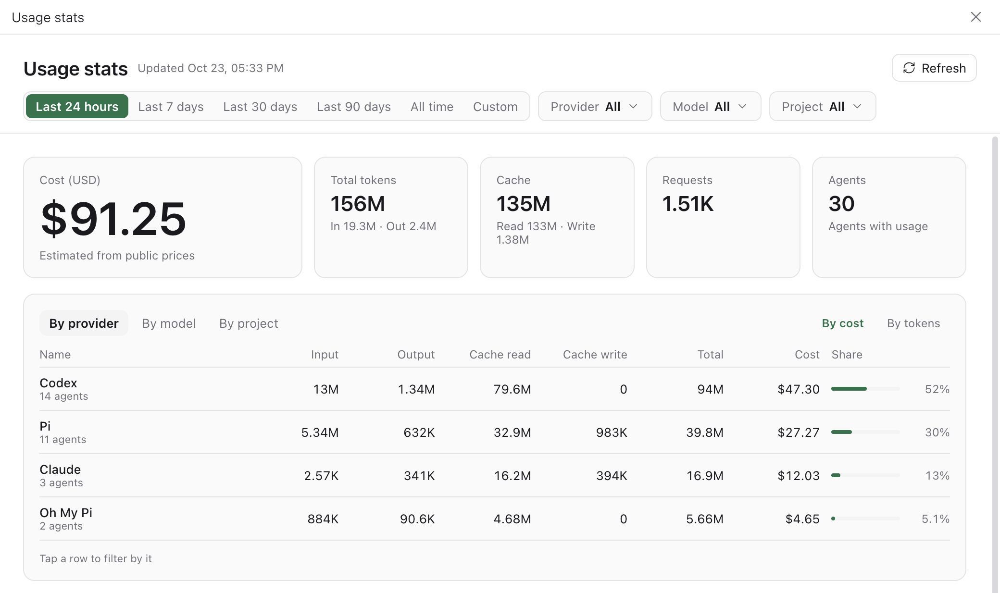
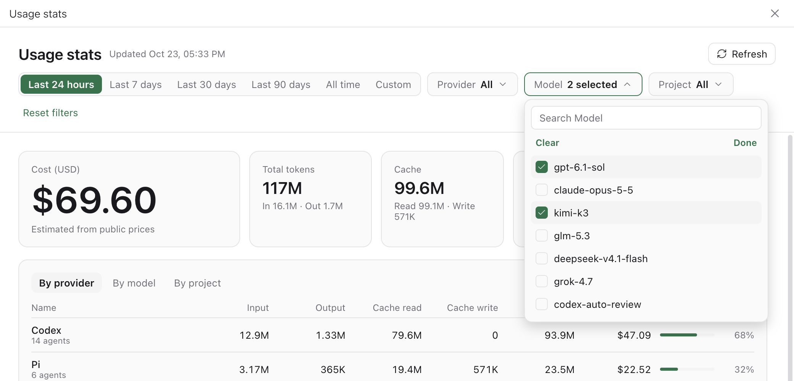
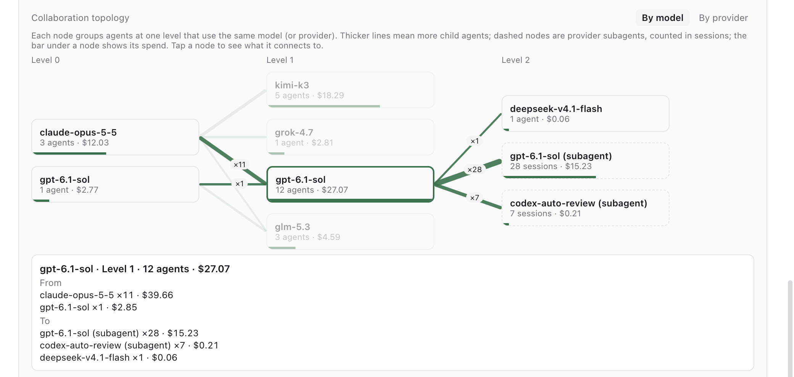
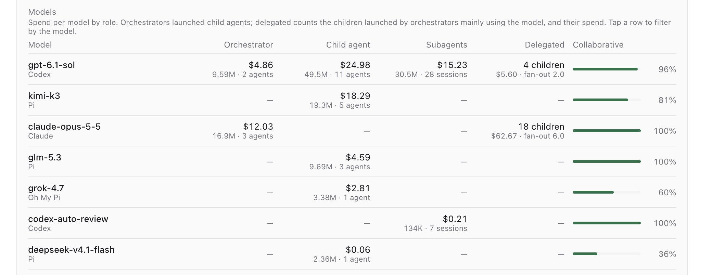
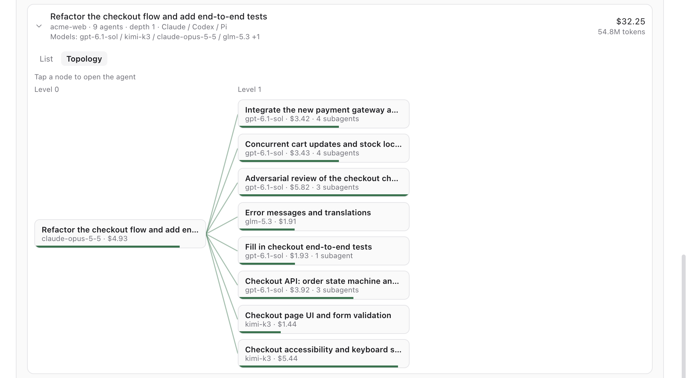
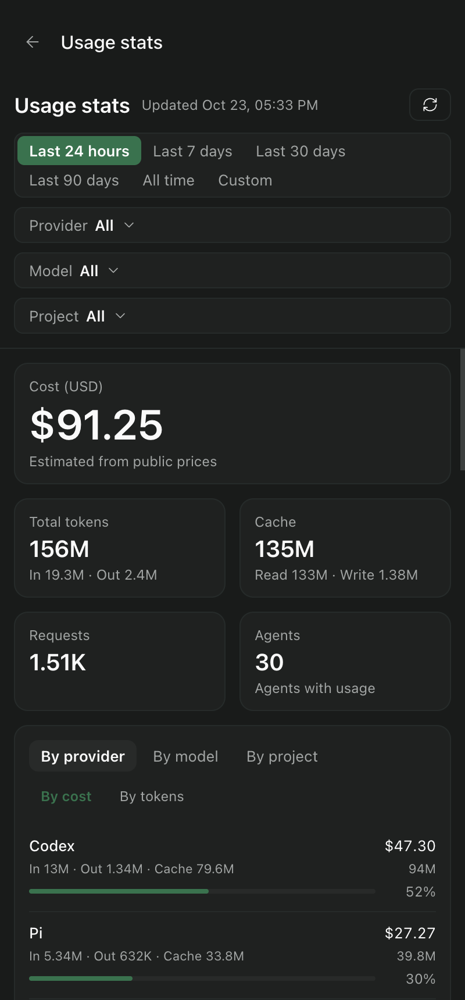

# Paseo Stats

[简体中文](./README.zh-CN.md)

A [Paseo](https://paseo.sh) plugin that reports token usage and USD cost of your agents by provider, model and project, and shows how agents collaborate.



## Features

- **Three breakdowns**: input, output, cache read, cache write, total tokens, cost and share by provider, model or project. Sort by cost or tokens; tap a row to filter by it.
- **Time ranges**: last 24 hours (default), 7, 30 or 90 days, all time, or a custom range.
- **Filters**: searchable multi-select dropdowns for providers, models and projects that scope the whole screen.
- **Multi-agent collaboration**: collaborations, child agents, average and maximum fan-out, depth, child agent cost share, provider pairs such as Claude to Codex, and the top collaborations with their members. Provider-native subagents (Codex threads, Claude subagents) are counted separately.
- **Collaboration by model**: each model's spend as orchestrator, child agent and provider subagent, its collaborative share, what orchestrators on that model delegated (children, spend, fan-out), and parent → child pairs by model or provider, such as `claude-opus-5-5 → gpt-6.1-sol ×93`. Tap a model to filter the page by it.
- **Topology graphs**: a layered graph of how agents launch each other, grouped by model or provider per level, with line thickness for the number of children and dashed nodes for provider subagents; tap a node to highlight and list its links. Each collaboration in the ranking also has an agent-level topology view; tap a node to open that agent.
- **Hot updates**: new GitHub releases show up in the app with a one-click update, or update automatically. Paseo keeps running.

## Screenshots

> All screenshots use synthetic data generated by `scripts/demo-ledger.mjs`.

### Searchable multi-select filters

Provider, model and project dropdowns support search and multiple selections, and together scope the whole screen.



### Collaboration topology

Shows which agents launched which, level by level. Tap a node to highlight its links and list their counts and spend below the graph.



### Models

Each model's spend as orchestrator, child agent and provider subagent, what it delegated, and its collaborative share.



### Topology of one collaboration

Expand a collaboration in the ranking and switch to Topology; tap a node to open that agent.



### Mobile and dark mode



## Data sources

Paseo keeps no usage history, so the plugin reads provider session logs on the daemon machine and links each session to its Paseo agent:

| Provider | Logs                                                       |
| -------- | ---------------------------------------------------------- |
| Claude   | `~/.claude/projects` (or `CLAUDE_CONFIG_DIR`)              |
| Codex    | `~/.codex/sessions`, `archived_sessions` (or `CODEX_HOME`) |
| Pi       | `~/.pi/agent/sessions` (or `PI_CODING_AGENT_DIR`)          |
| Oh My Pi | `~/.omp/agent/sessions`                                    |

Usage is copied into a ledger at `~/.paseo/plugin-data/paseo-stats`, so it survives log cleanup. Syncs run after each agent turn, every 10 minutes, and when the screen opens.

Costs are estimates: costs recorded in logs (Pi, Oh My Pi) are used as is; otherwise custom prices from the settings or [LiteLLM](https://github.com/BerriAI/litellm) public prices, including cache rates, apply.

## Install

Requires Paseo `>= 0.12.0` with plugins enabled under Settings → Plugins.

```bash
# Pin a release (recommended; enables in-app updates)
paseo plugin install github:DueGin/paseo-stats --ref v0.1.0
```

Open "Usage stats" in the sidebar footer or search for it with ⌘K. Settings live under Settings → Plugins → paseo-stats → ⋯.

## Updating

- **In the app**: a banner on the stats screen offers new releases; "Update automatically" in the settings checks every 6 hours.
- **CLI**: `paseo plugin update paseo-stats --ref vX.Y.Z`.

Updates go through `paseo plugin update`; the plugin reloads and the daemon keeps running. Copies installed from a local directory cannot update themselves: `git pull`, then `paseo plugin reload paseo-stats`. If the daemon cannot find the `paseo` CLI, set `PASEO_CLI` in its environment.

## Development

Uses Node.js 24 (`.nvmrc`).

```bash
npm ci
npm run dev      # hot reload: links this directory into the local daemon and reloads on save
npm run check    # typecheck, tests, formatting, version consistency
```

If the plugin id is already installed from another source, run `npm run dev -- --id paseo-stats-dev`. Pass `--home <path>` to target another daemon home.

README screenshots come in two sets, `docs/images/en` and `docs/images/zh`, and use synthetic data rather than real projects or usage. To retake them, write a demo ledger in the matching language with `node scripts/demo-ledger.mjs <PASEO_HOME>/plugin-data/paseo-stats --lang en|zh`, then capture the screens from that throwaway daemon. Point the daemon's `HOME` at an empty directory so it reads no local logs.

## Releasing

```bash
npm version patch   # or minor / major: syncs shared/version.ts, commits, tags vX.Y.Z
git push --follow-tags
```

Pushing a `v*` tag runs the [release workflow](.github/workflows/release.yml): it checks that the tag is on main and matches the version, runs `npm run check`, packs the plugin and creates a GitHub release with the `.tgz` and generated notes. Tags containing `-` (such as `v0.2.0-beta.1`) become prereleases and are not offered as in-app updates.

Optionally add an `NPM_TOKEN` repository secret to also publish to npm with provenance; without it that step is skipped.

## License

[MIT](./LICENSE)
